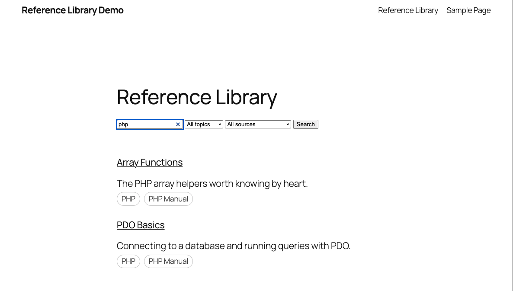

# Reference Library

A searchable reference library for WordPress. Add entries (notes, snippets, how-tos), organize them by topic and source, and let visitors search and filter them from any page with a shortcode.



## Features

- `reference_entry` custom post type for your entries
- `rl_topic` (hierarchical) and `rl_source` (tag-style) taxonomies
- `[reference_library]` shortcode: search box, topic and source filters, results list
- Live results with jQuery and AJAX as you type or change a filter (no page reload)
- Works without JavaScript: the same form falls back to a normal page-load search
- Nonce verification, input sanitization and output escaping throughout
- **Loading status:** a "Searching…" message appears while results load, and the list fades so it's clear something is happening.
- **Topic and source tags:** every result shows its topics and sources as small tag pills.
- **Shareable search URLs:** the search and filters are saved in the address bar (`?rl_search=php`), so a filtered view can be bookmarked or shared and survives a refresh.

## Usage

1. Copy the `reference-library` folder into `wp-content/plugins/` and activate it.
2. Add entries under **Reference Library > Add New Entry**, and assign topics and sources.
3. Put this shortcode on any page:

```
[reference_library]
```

## Try it locally

This repo includes a [WordPress Playground](https://wordpress.github.io/wordpress-playground/) blueprint that boots a demo site with six sample entries and a `/library` page:

```
npx @wp-playground/cli@latest server --auto-mount --blueprint=blueprint.json
```

Then open the site and go to **Reference Library** in the menu.

## Structure

```
reference-library.php        Plugin header and constants
includes/post-types.php      Post type and taxonomies
includes/shortcode.php       Shortcode, query and rendering
includes/ajax.php            Script loading and AJAX search handler
assets/js/reference-library.js   Live search (jQuery)
blueprint.json               Playground demo setup
playground-setup.php         Sample entries and demo page
```

## How the search works

`rl_get_entries()` builds one `WP_Query` from the search text and the selected topic and source. Both the shortcode (page load) and the AJAX handler (live results) call the same query and rendering functions, so results are identical either way.

## Development notes

Developed and tested on WordPress 7.1 with PHP 8.3.

## License

MIT